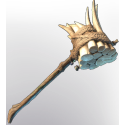

# Soothsayer

| | |
|---|---|
| Category | [Weapons](../../categories/weapons.md) |
| Rarity | 🟠 Legendary |
| Level | 1-55 |
| Max stack | 1 |
| Item ID | `2528480161` |
| Internal name | `Weapon_T3_2H_Lore_HammerEpic_ministory_19` |

One of 6 versions of this item: see [Soothsayer](../../objects/weapons/soothsayer.md) for all of them and how they differ.

## Description

A hammer adorned with an ancient petrified tusk. Tusks and teeth were used by the Vukah for mystical purposes.

## Stats

| | |
|---|---|
| Slot | Melee weapon |
| Damage type | Blunt |
| Parry Power | 1 |
| Attack Speed | 0.774 s |

## Enhancements

Unlocked one after another as the item is upgraded, in this order. Armor and damage bonuses grow with the item level, so their numbers are shown in game only.

| | Enhancement | Effect |
|:---:|---|---|
| 1 | Heavy | - |
| 2 | Heavy | - |
| 3 | Health Leech | On Hit Leech 5% Damage as Health |
| 4 | Heavy | - |
| 5 | Precise | +5 Precise |

---

[← Weapons](../../categories/weapons.md) · [All categories](../../README.md)
