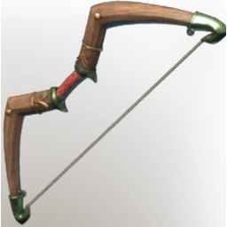

# Spearfisher Bow

| | |
|---|---|
| Category | [Weapons](../../categories/weapons.md) |
| Rarity | 🔵 Rare |
| Level | 46 |
| Max stack | 1 |
| Item ID | `2187973877` |
| Internal name | `Craft_Weapon_T7_2H_Lore_Bow_ministory_03` |

One of 2 versions of this item: see [Spearfisher Bow](../../objects/weapons/spearfisher-bow.md) for all of them and how they differ.

## Description

A bow used by the Drak to try and catch fish through arrows and luck. They weren't so succesfull with their venture, but perhaps the bow could still be useful in a more traditional sense.

## Stats

| | |
|---|---|
| Slot | Ranged weapon |
| Draw Speed | 0.6 s |
| Arrow Speed | 20 |

## Enhancements

Unlocked one after another as the item is upgraded, in this order. Armor and damage bonuses grow with the item level, so their numbers are shown in game only.

| | Enhancement | Effect |
|:---:|---|---|
| 1 | Heavy | - |
| 2 | Stalking | +10 Damage against Wildlife and Wildbeasts |
| 3 | Heavy | - |
| 4 | Ophidian | +10 Damage against Drak |
| 5 | Heavy | - |

## How to get it

- **Hunter**: 4 × [Celesthium Bars](../../items/materials/celesthium-bars-2893592883.md), 2 × [String](../../items/materials/string-419344916.md), 4 × [Conifer Logs](../../items/materials/conifer-logs-1475408789.md), 4 × [T6 Green Essence (Ectoplasm Aggregate??)](../../items/materials/t6-green-essence-ectoplasm-aggregate-4005698976.md) → 1 ×

---

[← Weapons](../../categories/weapons.md) · [All categories](../../README.md)
