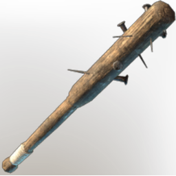

# Spiked Club

| | |
|---|---|
| Category | [Weapons](../../categories/weapons.md) |
| Rarity | ⚪ Common |
| Level | 5 |
| Max stack | 1 |
| Item ID | `1985879197` |
| Internal name | `Weapon_T1_1H_Mace_Craft` |

## Description

A slightly improved version of the Wooden Club, reinforced with spikes.

## Stats

| | |
|---|---|
| Slot | Melee weapon |
| Damage type | Blunt |
| Attack Speed | 0.6 s |

## Enhancements

Unlocked one after another as the item is upgraded, in this order. Armor and damage bonuses grow with the item level, so their numbers are shown in game only.

| | Enhancement | Effect |
|:---:|---|---|
| 1 | Heavy | - |

## How to get it

- **Blacksmith**: 4 × [Nails](../../items/materials/nails-2743545700.md), 4 × [Wood Logs](../../items/materials/wood-logs-722268629.md) → 1 ×

---

[← Weapons](../../categories/weapons.md) · [All categories](../../README.md)
