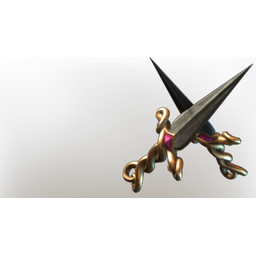

# Valor Heart Dagger

| | |
|---|---|
| Category | [Weapons](../../categories/weapons.md) |
| Rarity | 🔵 Rare |
| Level | 21 |
| Max stack | 1 |
| Item ID | `3717136224` |
| Internal name | `Craft_Weapon_T4_2H_Lore_DaggersEpic_Parry_bard_Hint02` |

One of 7 versions of this item: see [Valor Heart Dagger](../../objects/weapons/valor-heart-dagger.md) for all of them and how they differ.

## Description

A dagger that can easily be hidden underneath lavish sleeves or dressy skirts. It's quick and easy to unsheath in times of need!

## Stats

| | |
|---|---|
| Slot | Melee weapon |
| Damage type | Piercing |
| Attack Speed | 0.4 s |
| Parry Power | 1 |

## Enhancements

Unlocked one after another as the item is upgraded, in this order. Armor and damage bonuses grow with the item level, so their numbers are shown in game only.

| | Enhancement | Effect |
|:---:|---|---|
| 1 | Precise | +7 Precise |
| 2 | Merciless | +18 Merciless |
| 3 | Heavy | - |
| 4 | Merciless | +18 Merciless |
| 5 | Retaliation | A percentage of incoming damage is dealt back to the attacker |

## How to get it

- **Hunter**: 2 × [Iron Bars](../../items/materials/iron-bars-159114158.md), 4 × [Tin Bars](../../items/materials/tin-bars-1072522988.md), 4 × [Nails](../../items/materials/nails-2743545700.md) → 1 ×

---

[← Weapons](../../categories/weapons.md) · [All categories](../../README.md)
