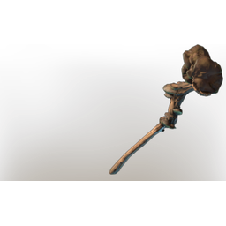

# Vaporous Staff

| | |
|---|---|
| Category | [Weapons](../../categories/weapons.md) |
| Rarity | ⚪ Common |
| Level | 1-55 |
| Max stack | 1 |
| Item ID | `2749653597` |
| Internal name | `Weapon_T1-TX_2H_Staff_Enemy_Vukah` |

## Description

A basic magical staff that allows the wearer to release Spells at the cost of Mana and Magical Ammunition.

The Spells need to be crafted or found.

## Stats

| | |
|---|---|
| Slot | Ranged weapon |

## Enhancements

Unlocked one after another as the item is upgraded, in this order. Armor and damage bonuses grow with the item level, so their numbers are shown in game only.

| | Enhancement | Effect |
|:---:|---|---|
| 1 | Heavy | - |
| 2 | Health Leech | On Hit Leech 5% Damage as Health |
| 3 | Mana Leech | On Hit Leech %Percentage% Damage as Mana |
| 4 | Precise | +4 Precise |
| 5 | Stalking | +5 Damage against Wildlife and Wildbeasts |

---

[← Weapons](../../categories/weapons.md) · [All categories](../../README.md)
