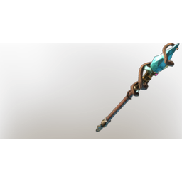

# Wand T5 epic 01

| | |
|---|---|
| Category | [Weapons](../../categories/weapons.md) |
| Rarity | ⚪ Common |
| Level | 1-55 |
| Max stack | 1 |
| Item ID | `3270175842` |
| Internal name | `Weapon_T5_1H_WandEpic_01_Ice` |

## Description

Wand  T5 epic  01 desc  - Multishot: Fires multiple projectiles but at reduced damage

## Stats

| | |
|---|---|
| Slot | Magic weapon |
| Damage type | Ice |
| Overcharge | 24 |
| Attack Speed | 0.6 s |
| Mana Regeneration | 12 |
| Multishot | 1 |

## Enhancements

Unlocked one after another as the item is upgraded, in this order. Armor and damage bonuses grow with the item level, so their numbers are shown in game only.

| | Enhancement | Effect |
|:---:|---|---|
| 1 | Heavy | - |
| 2 | Brutal | +20 Brutal |
| 3 | Heavy | - |
| 4 | Mana Leech | On Hit Leech %Percentage% Damage as Mana |
| 5 | Precise | +6 Precise |

---

[← Weapons](../../categories/weapons.md) · [All categories](../../README.md) · [JSON](wand-t5-epic-01-3270175842.json)
