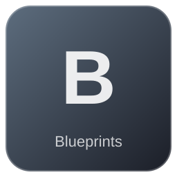

# Roof Corner In

**2 versions** of this item exist in the game (Blueprints). They share the name.

The versions have the same level range, rarity, stack size and texts; the game keeps them as separate item IDs. Compare the pictures in the table to see whether they look different.

| | Version | Rarity | Level | Stack | Item ID | Own text |
|:---:|---|---|:---:|:---:|---|---|
|  | [1. Roof Corner In](../../items/blueprints/roof-corner-in-2297453360.md) | ⚪ Common | - | 1 | `2297453360` | - |
|  | [2. Roof Corner In](../../items/blueprints/roof-corner-in-3722239847.md) | ⚪ Common | - | 1 | `3722239847` | - |

---

[← Blueprints](../../categories/blueprints.md) · [All categories](../../README.md)
