# Book I

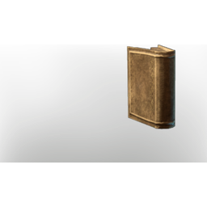

**14 versions** of this item exist in the game (Building). They share the name and the description and lore.

The versions have the same level range, rarity, stack size and texts; the game keeps them as separate item IDs. Compare the pictures in the table to see whether they look different.

| | Version | Rarity | Level | Stack | Item ID | Own text |
|:---:|---|---|:---:|:---:|---|---|
| 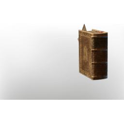 | [1. Book I](../../items/buildtools/book-i-1042567701.md) | ⚪ Common | - | 50 | `1042567701` | - |
| 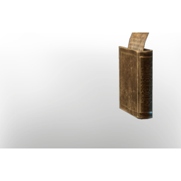 | [2. Book I](../../items/buildtools/book-i-1665817031.md) | ⚪ Common | - | 50 | `1665817031` | - |
| 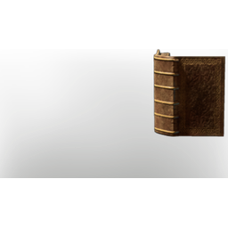 | [3. Book I](../../items/buildtools/book-i-1878602124.md) | ⚪ Common | - | 50 | `1878602124` | - |
| 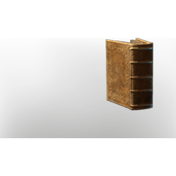 | [4. Book I](../../items/buildtools/book-i-1920341845.md) | ⚪ Common | - | 50 | `1920341845` | - |
| 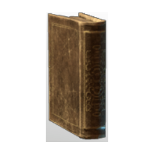 | [5. Book I](../../items/buildtools/book-i-2283198170.md) | ⚪ Common | - | 50 | `2283198170` | - |
| 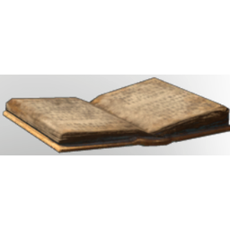 | [6. Book I](../../items/buildtools/book-i-2548133338.md) | ⚪ Common | - | 50 | `2548133338` | - |
| 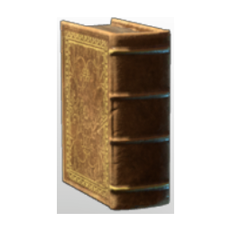 | [7. Book I](../../items/buildtools/book-i-2975370828.md) | ⚪ Common | - | 50 | `2975370828` | - |
| 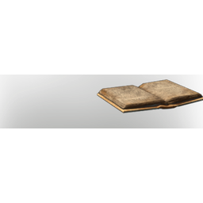 | [8. Book I](../../items/buildtools/book-i-3330526371.md) | ⚪ Common | - | 50 | `3330526371` | - |
| 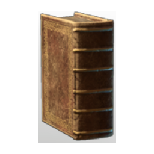 | [9. Book I](../../items/buildtools/book-i-3853710961.md) | ⚪ Common | - | 50 | `3853710961` | - |
|  | [10. Book I](../../items/buildtools/book-i-413542990.md) | ⚪ Common | - | 50 | `413542990` | - |
| 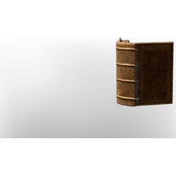 | [11. Book I](../../items/buildtools/book-i-4242562036.md) | ⚪ Common | - | 50 | `4242562036` | - |
| 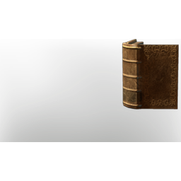 | [12. Book I](../../items/buildtools/book-i-589587638.md) | ⚪ Common | - | 50 | `589587638` | - |
| 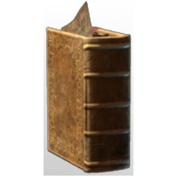 | [13. Book I](../../items/buildtools/book-i-676824530.md) | ⚪ Common | - | 50 | `676824530` | - |
|  | [14. Book I](../../items/buildtools/book-i-743954578.md) | ⚪ Common | - | 50 | `743954578` | - |

## Description

A Book. Conveyer of Thougt. Foundation of Progress. Expanders of Minds. Vessel of Knowledge. Bonfire of imagination.

## Lore

Furniture

---

[← Building](../../categories/buildtools.md) · [All categories](../../README.md)
