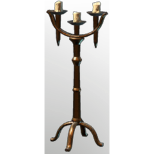

# Candleholder

**2 versions** of this item exist in the game (Building). They share the name and the description and lore.

The versions have the same level range, rarity, stack size and texts; the game keeps them as separate item IDs. Compare the pictures in the table to see whether they look different.

| | Version | Rarity | Level | Stack | Item ID | Own text |
|:---:|---|---|:---:|:---:|---|---|
|  | [1. Candleholder](../../items/buildtools/candleholder-2030375070.md) | ⚪ Common | - | 50 | `2030375070` | - |
|  | [2. Candleholder](../../items/buildtools/candleholder-3107093572.md) | ⚪ Common | - | 50 | `3107093572` | - |

## Description

An illumination item that can be placed in your home.

Provides **comfort** which increases the duration of the Rested Bonus.

## Lore

Illumination

---

[← Building](../../categories/buildtools.md) · [All categories](../../README.md) · [JSON](candleholder.json)
