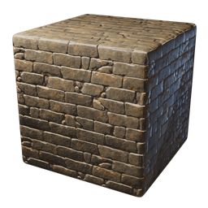
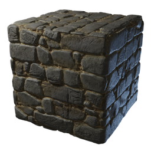

# City Wall Stone Block

**2 versions** of this item exist in the game (Building). They share the name and the where to find.

They differ in description; the table shows the values per version.

| | Version | Rarity | Level | Stack | Item ID | Own text |
|:---:|---|---|:---:|:---:|---|---|
|  | [1. City Wall Stone Block](../../items/buildtools/city-wall-stone-block-1956408861.md) | ⚪ Common | - | 5000 | `1956408861` | - |
|  | [2. City Wall Stone Block](../../items/buildtools/city-wall-stone-block-3379333313.md) | ⚪ Common | - | 5000 | `3379333313` | description |

## Description per version

**1.** Neglected, it protects the outer walls of the city with its friends, the plants.

**2.** A classic building block used in the Kindlewastes. It was refined by mixing in some imported sandstone.

## Where to find

Workbench

---

[← Building](../../categories/buildtools.md) · [All categories](../../README.md)
