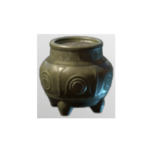
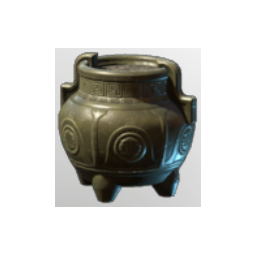

# Empty Cymbidum Pot

**2 versions** of this item exist in the game (Building). They share the name and the description and lore.

The versions have the same level range, rarity, stack size and texts; the game keeps them as separate item IDs. Compare the pictures in the table to see whether they look different.

| | Version | Rarity | Level | Stack | Item ID | Own text |
|:---:|---|---|:---:|:---:|---|---|
|  | [1. Empty Cymbidum Pot](../../items/buildtools/empty-cymbidum-pot-2125538426.md) | ⚪ Common | - | 50 | `2125538426` | - |
|  | [2. Empty Cymbidum Pot](../../items/buildtools/empty-cymbidum-pot-4135259126.md) | ⚪ Common | - | 50 | `4135259126` | - |

## Description

A lovely pot of flowers to beautify your world.

## Lore

Potted Plant

---

[← Building](../../categories/buildtools.md) · [All categories](../../README.md)
