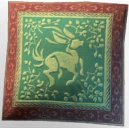

# Fae Deer Pillow

**2 versions** of this item exist in the game (Building). They share the name and the description and lore.

The versions have the same level range, rarity, stack size and texts; the game keeps them as separate item IDs. Compare the pictures in the table to see whether they look different.

| | Version | Rarity | Level | Stack | Item ID | Own text |
|:---:|---|---|:---:|:---:|---|---|
|  | [1. Fae Deer Pillow](../../items/buildtools/fae-deer-pillow-1936163292.md) | ⚪ Common | - | 50 | `1936163292` | - |
|  | [2. Fae Deer Pillow](../../items/buildtools/fae-deer-pillow-3507499853.md) | ⚪ Common | - | 50 | `3507499853` | - |

## Description

A decorative pillow that's been adorned with a Fae Deer motiv. It seems to be running wild through wind and bushes.

## Lore

Furniture

---

[← Building](../../categories/buildtools.md) · [All categories](../../README.md)
