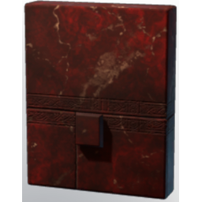
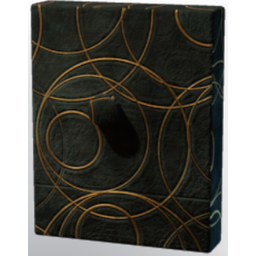

# Fake Ancient Wall Secret

**2 versions** of this item exist in the game (Building). They share the name and the description and lore.

The versions have the same level range, rarity, stack size and texts; the game keeps them as separate item IDs. Compare the pictures in the table to see whether they look different.

| | Version | Rarity | Level | Stack | Item ID | Own text |
|:---:|---|---|:---:|:---:|---|---|
|  | [1. Fake Ancient Wall Secret](../../items/buildtools/fake-ancient-wall-secret-2172312678.md) | 🔵 Rare | - | 50 | `2172312678` | - |
|  | [2. Fake Ancient Wall Secret](../../items/buildtools/fake-ancient-wall-secret-543479720.md) | 🔵 Rare | - | 50 | `543479720` | - |

## Description

A fake secret you can install in your base to confuse others.

## Lore

Furniture

---

[← Building](../../categories/buildtools.md) · [All categories](../../README.md)
