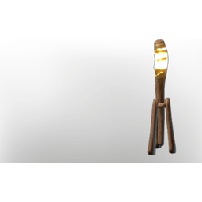
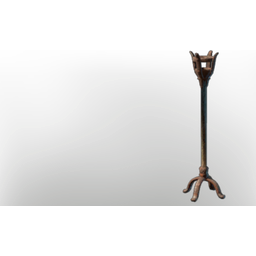

# Standing Torch

**2 versions** of this item exist in the game (Building). They share the name and the description and lore.

They differ in max stack; the table shows the values per version.

| | Version | Rarity | Level | Stack | Item ID | Own text |
|:---:|---|---|:---:|:---:|---|---|
|  | [1. Standing Torch](../../items/buildtools/standing-torch-1191571537.md) | ⚪ Common | - | 50 | `1191571537` | - |
|  | [2. Standing torch](../../items/buildtools/standing-torch-8841766.md) | ⚪ Common | - | 1000 | `8841766` | - |

## Description

An illumination item that can be placed in your home.

Provides **comfort** which increases the duration of the Rested Bonus.

## Lore

Illumination

---

[← Building](../../categories/buildtools.md) · [All categories](../../README.md) · [JSON](standing-torch.json)
