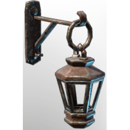

# Wall Lantern

**2 versions** of this item exist in the game (Building). They share the name and the description.

They differ in lore; the table shows the values per version.

| | Version | Rarity | Level | Stack | Item ID | Own text |
|:---:|---|---|:---:|:---:|---|---|
|  | [1. Wall Lantern](../../items/buildtools/wall-lantern-2560383707.md) | ⚪ Common | - | 50 | `2560383707` | - |
|  | [2. Wall Lantern](../../items/buildtools/wall-lantern-3019273830.md) | ⚪ Common | - | 50 | `3019273830` | - |

## Description

An illumination item that can be placed in your home.

Provides **comfort** which increases the duration of the Rested Bonus.

## Lore per version

**1.** Illumination

---

[← Building](../../categories/buildtools.md) · [All categories](../../README.md) · [JSON](wall-lantern.json)
