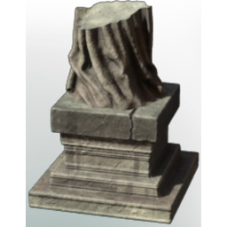
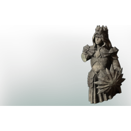

# Broken Piece of a Statue

**3 versions** of this item exist in the game (Collectibles). They share the name and the description.

The versions have the same level range, rarity, stack size and texts; the game keeps them as separate item IDs. Compare the pictures in the table to see whether they look different.

| | Version | Rarity | Level | Stack | Item ID | Own text |
|:---:|---|---|:---:|:---:|---|---|
|  | [1. Broken Piece of a Statue](../../items/collectibles/broken-piece-of-a-statue-1556757497.md) | 🔵 Rare | - | 20 | `1556757497` | - |
|  | [2. Broken Piece of a Statue](../../items/collectibles/broken-piece-of-a-statue-2624605842.md) | 🔵 Rare | - | 20 | `2624605842` | - |
|  | [3. Broken Piece of a Statue](../../items/collectibles/broken-piece-of-a-statue-3883219916.md) | 🔵 Rare | - | 20 | `3883219916` | - |

## Description

Try to find the missing pieces to reassemble a Statue.

---

[← Collectibles](../../categories/collectibles.md) · [All categories](../../README.md)
