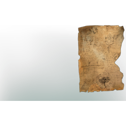

# Ripped Alchemist's Wall Hanging

**2 versions** of this item exist in the game (Collectibles). They share the name.

They differ in description; the table shows the values per version.

| | Version | Rarity | Level | Stack | Item ID | Own text |
|:---:|---|---|:---:|:---:|---|---|
|  | [1. Ripped Alchemist's Wall Hanging](../../items/collectibles/ripped-alchemist-s-wall-hanging-1372134498.md) | 🔵 Rare | - | 20 | `1372134498` | - |
|  | [2. Ripped Alchemist's Wall Hanging](../../items/collectibles/ripped-alchemist-s-wall-hanging-2365197861.md) | 🔵 Rare | - | 20 | `2365197861` | description |

## Description per version

**1.** The second half of a wall hanging, visualizing the complex simbiosis of the natural, and magical. When paired with the other half, perhaps this ancient wisdom could be understood.

**2.** A ripped piece of fabric, detailing alchemical wisdom. Someone might be able to decipher it if you had the other half!

---

[← Collectibles](../../categories/collectibles.md) · [All categories](../../README.md)
