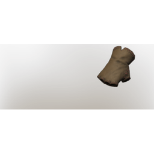
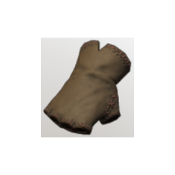

# T2 Healer Arms

**2 versions** of this item exist in the game (Armor & Equipment). They share the name and the description.

The versions have the same level range, rarity, stack size and texts; the game keeps them as separate item IDs. Compare the pictures in the table to see whether they look different.

| | Version | Rarity | Level | Stack | Item ID | Own text |
|:---:|---|---|:---:|:---:|---|---|
|  | [1. T2 Healer Arms](../../items/equipment/t2-healer-arms-3616614020.md) | 🔵 Rare | 10 | 1 | `3616614020` | - |
|  | [2. T2 Healer Arms](../../items/equipment/t2-healer-arms-614770460.md) | 🔵 Rare | 10 | 1 | `614770460` | - |

## Description

These gloves allow nimble fingers to patch up wounds when in a pinch.

---

[← Armor & Equipment](../../categories/equipment.md) · [All categories](../../README.md)
