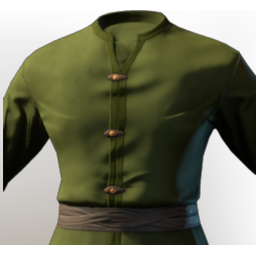

# T2 Mage Chest

**2 versions** of this item exist in the game (Armor & Equipment). They share the name and the description.

The versions have the same level range, rarity, stack size and texts; the game keeps them as separate item IDs. Compare the pictures in the table to see whether they look different.

| | Version | Rarity | Level | Stack | Item ID | Own text |
|:---:|---|---|:---:|:---:|---|---|
|  | [1. T2 Mage Chest](../../items/equipment/t2-mage-chest-3494556891.md) | 🔵 Rare | 10 | 1 | `3494556891` | - |
|  | [2. T2 Mage Chest](../../items/equipment/t2-mage-chest-3532723599.md) | 🔵 Rare | 10 | 1 | `3532723599` | - |

## Description

A fibre-made garment held together by oakwood buttons, a woven belt and magic itself! Mostly by the buttons, though.

---

[← Armor & Equipment](../../categories/equipment.md) · [All categories](../../README.md) · [JSON](t2-mage-chest.json)
