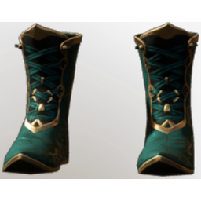
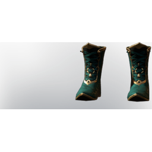

# T4 Healer Boots

**2 versions** of this item exist in the game (Armor & Equipment). They share the name and the description.

The versions have the same level range, rarity, stack size and texts; the game keeps them as separate item IDs. Compare the pictures in the table to see whether they look different.

| | Version | Rarity | Level | Stack | Item ID | Own text |
|:---:|---|---|:---:|:---:|---|---|
|  | [1. T4 Healer Boots](../../items/equipment/t4-healer-boots-3615964892.md) | 🔵 Rare | 20 | 1 | `3615964892` | - |
|  | [2. T4 Healer Boots](../../items/equipment/t4-healer-boots-902782975.md) | 🔵 Rare | 20 | 1 | `902782975` | - |

## Description

Comfortable shoes which are ideal for lounging in a library.

---

[← Armor & Equipment](../../categories/equipment.md) · [All categories](../../README.md) · [JSON](t4-healer-boots.json)
