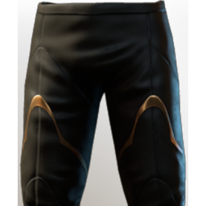

# T4 Mage Legs

**2 versions** of this item exist in the game (Armor & Equipment). They share the name and the description.

The versions have the same level range, rarity, stack size and texts; the game keeps them as separate item IDs. Compare the pictures in the table to see whether they look different.

| | Version | Rarity | Level | Stack | Item ID | Own text |
|:---:|---|---|:---:|:---:|---|---|
|  | [1. T4 Mage Legs](../../items/equipment/t4-mage-legs-1616516574.md) | 🔵 Rare | 20 | 1 | `1616516574` | - |
|  | [2. T4 Mage Legs](../../items/equipment/t4-mage-legs-2214049957.md) | 🔵 Rare | 20 | 1 | `2214049957` | - |

## Description

Elegantly held together with cobalt linen and thread. Truly fitting for a sophisticated mage!

---

[← Armor & Equipment](../../categories/equipment.md) · [All categories](../../README.md) · [JSON](t4-mage-legs.json)
