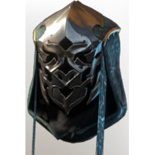
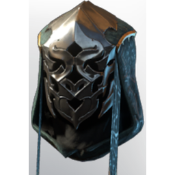

# T4 Ranger Helmet

**2 versions** of this item exist in the game (Armor & Equipment). They share the name and the description.

The versions have the same level range, rarity, stack size and texts; the game keeps them as separate item IDs. Compare the pictures in the table to see whether they look different.

| | Version | Rarity | Level | Stack | Item ID | Own text |
|:---:|---|---|:---:|:---:|---|---|
|  | [1. T4 Ranger Helmet](../../items/equipment/t4-ranger-helmet-2666667832.md) | 🔵 Rare | 20 | 1 | `2666667832` | - |
|  | [2. T4 Ranger Helmet](../../items/equipment/t4-ranger-helmet-3527833310.md) | 🔵 Rare | 20 | 1 | `3527833310` | - |

## Description

The cloth straps attached to this mask glide softly in the wind, helping to discern wind direction and speed.

---

[← Armor & Equipment](../../categories/equipment.md) · [All categories](../../README.md)
