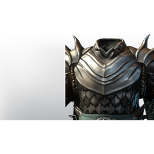

# T4 Tank Chest

**2 versions** of this item exist in the game (Armor & Equipment). They share the name and the description.

The versions have the same level range, rarity, stack size and texts; the game keeps them as separate item IDs. Compare the pictures in the table to see whether they look different.

| | Version | Rarity | Level | Stack | Item ID | Own text |
|:---:|---|---|:---:|:---:|---|---|
|  | [1. T4 Tank Chest](../../items/equipment/t4-tank-chest-2382917560.md) | 🔵 Rare | 20 | 1 | `2382917560` | - |
|  | [2. T4 Tank Chest](../../items/equipment/t4-tank-chest-403577806.md) | 🔵 Rare | 20 | 1 | `403577806` | - |

## Description

An incredibly sturdy chestpiece, often worn by generals or select members of the royal guard. It inspired fear as much as respect.

---

[← Armor & Equipment](../../categories/equipment.md) · [All categories](../../README.md) · [JSON](t4-tank-chest.json)
