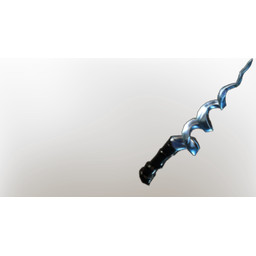

# Cryptic wand

**7 versions** of this item exist in the game (Weapons). They share the name and the description.

They differ in level range and rarity; the table shows the values per version.

| | Version | Rarity | Level | Stack | Item ID | Own text |
|:---:|---|---|:---:|:---:|---|---|
|  | [1. Cryptic wand](../../items/weapons/cryptic-wand-4048093059.md) | 🔵 Rare | 11 | 1 | `4048093059` | - |
|  | [2. Cryptic wand](../../items/weapons/cryptic-wand-4294860398.md) | 🔵 Rare | 16 | 1 | `4294860398` | - |
|  | [3. Cryptic wand](../../items/weapons/cryptic-wand-4192516670.md) | 🔵 Rare | 21 | 1 | `4192516670` | - |
|  | [4. Cryptic wand](../../items/weapons/cryptic-wand-2908736852.md) | 🔵 Rare | 26 | 1 | `2908736852` | - |
|  | [5. Cryptic wand](../../items/weapons/cryptic-wand-2563601506.md) | 🔵 Rare | 36 | 1 | `2563601506` | - |
|  | [6. Cryptic wand](../../items/weapons/cryptic-wand-2053280664.md) | 🔵 Rare | 46 | 1 | `2053280664` | - |
|  | [7. Cryptic wand](../../items/weapons/cryptic-wand-3739626235.md) | 🟣 Epic | 1-55 | 1 | `3739626235` | - |

## Description

A strange wand which was covered by ashes. Its body bends and twists, but never breaks.  - Multishot: Fires multiple projectiles but at reduced damage

---

[← Weapons](../../categories/weapons.md) · [All categories](../../README.md)
