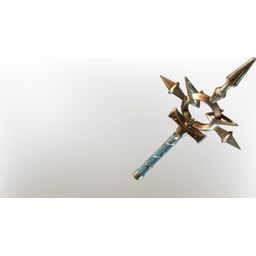

# Darya's Remorse

**2 versions** of this item exist in the game (Weapons). They share the name and the description.

They differ in level range and rarity; the table shows the values per version.

| | Version | Rarity | Level | Stack | Item ID | Own text |
|:---:|---|---|:---:|:---:|---|---|
|  | [1. Darya's Remorse](../../items/weapons/darya-s-remorse-3233786830.md) | 🔵 Rare | 46 | 1 | `3233786830` | - |
|  | [2. Darya's Remorse](../../items/weapons/darya-s-remorse-2642629621.md) | 🟠 Legendary | 1-55 | 1 | `2642629621` | - |

## Description

A heavy wand that's bright as the sun, decorated by a flower that wraps around the handle, blooming near the hilt. Despite it's radiance, you feel that it carried a dark energy - is it remorse, or the curse of the Shroud?

---

[← Weapons](../../categories/weapons.md) · [All categories](../../README.md) · [JSON](darya-s-remorse.json)
