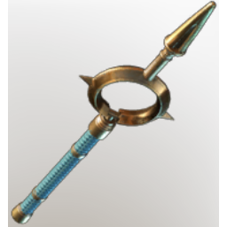

# Darya's Wand

**4 versions** of this item exist in the game (Weapons). They share the name and the description.

They differ in level range and rarity; the table shows the values per version.

| | Version | Rarity | Level | Stack | Item ID | Own text |
|:---:|---|---|:---:|:---:|---|---|
|  | [1. Darya's Wand](../../items/weapons/darya-s-wand-2104873327.md) | 🔵 Rare | 26 | 1 | `2104873327` | - |
|  | [2. Darya's Wand](../../items/weapons/darya-s-wand-1561187159.md) | 🔵 Rare | 36 | 1 | `1561187159` | - |
|  | [3. Darya's Wand](../../items/weapons/darya-s-wand-1142953776.md) | 🔵 Rare | 46 | 1 | `1142953776` | - |
|  | [4. Darya's Wand](../../items/weapons/darya-s-wand-2331017633.md) | 🟣 Epic | 1-55 | 1 | `2331017633` | - |

## Description

A wand that harnesses the power of the eclipse. It functions best when the sun is fully submerged in darkness, and only a faint rim of light shines through.

---

[← Weapons](../../categories/weapons.md) · [All categories](../../README.md)
