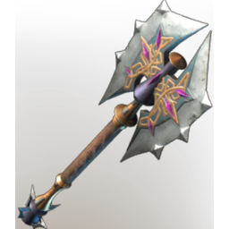
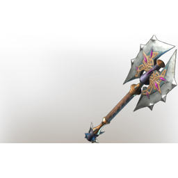

# Dragonsbane

**4 versions** of this item exist in the game (Weapons). They share the name and the description.

They differ in level range and rarity; the table shows the values per version.

| | Version | Rarity | Level | Stack | Item ID | Own text |
|:---:|---|---|:---:|:---:|---|---|
|  | [1. Dragonsbane](../../items/weapons/dragonsbane-1608083210.md) | 🔵 Rare | 26 | 1 | `1608083210` | - |
|  | [2. Dragonsbane](../../items/weapons/dragonsbane-2688480639.md) | 🔵 Rare | 36 | 1 | `2688480639` | - |
|  | [3. Dragonsbane](../../items/weapons/dragonsbane-2594618935.md) | 🔵 Rare | 46 | 1 | `2594618935` | - |
|  | [4. Dragonsbane](../../items/weapons/dragonsbane-729789776.md) | 🟠 Legendary | 1-55 | 1 | `729789776` | - |

## Description

An axe found inside the skullcap of a giant dragon skeleton.

---

[← Weapons](../../categories/weapons.md) · [All categories](../../README.md) · [JSON](dragonsbane.json)
