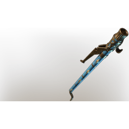
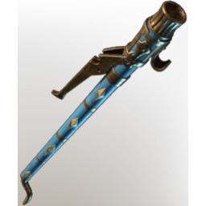

# Electric Initialiser

**2 versions** of this item exist in the game (Weapons). They share the name and the description.

They differ in level range and rarity; the table shows the values per version.

| | Version | Rarity | Level | Stack | Item ID | Own text |
|:---:|---|---|:---:|:---:|---|---|
|  | [1. Electric Initialiser](../../items/weapons/electric-initialiser-3848774794.md) | 🔵 Rare | 46 | 1 | `3848774794` | - |
|  | [2. Electric Initialiser](../../items/weapons/electric-initialiser-873336281.md) | 🟠 Legendary | 1-55 | 1 | `873336281` | - |

## Description

An electrifying wand that was previously used to start engines and machinery in an instant.

---

[← Weapons](../../categories/weapons.md) · [All categories](../../README.md) · [JSON](electric-initialiser.json)
