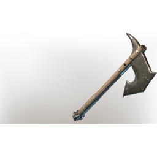

# Fenrig's Axe

**8 versions** of this item exist in the game (Weapons). They share the name and the description.

They differ in level range and rarity; the table shows the values per version.

| | Version | Rarity | Level | Stack | Item ID | Own text |
|:---:|---|---|:---:|:---:|---|---|
|  | [1. Fenrig's Axe](../../items/weapons/fenrig-s-axe-462958958.md) | 🔵 Rare | 6 | 1 | `462958958` | - |
|  | [2. Fenrig's Axe](../../items/weapons/fenrig-s-axe-2440163799.md) | 🔵 Rare | 11 | 1 | `2440163799` | - |
|  | [3. Fenrig's Axe](../../items/weapons/fenrig-s-axe-3530269879.md) | 🔵 Rare | 16 | 1 | `3530269879` | - |
|  | [4. Fenrig's Axe](../../items/weapons/fenrig-s-axe-1853225094.md) | 🔵 Rare | 21 | 1 | `1853225094` | - |
|  | [5. Fenrig's Axe](../../items/weapons/fenrig-s-axe-65433484.md) | 🔵 Rare | 26 | 1 | `65433484` | - |
|  | [6. Fenrig's Axe](../../items/weapons/fenrig-s-axe-1735564804.md) | 🔵 Rare | 36 | 1 | `1735564804` | - |
|  | [7. Fenrig's Axe](../../items/weapons/fenrig-s-axe-431218523.md) | 🔵 Rare | 46 | 1 | `431218523` | - |
|  | [8. Fenrig's Axe](../../items/weapons/fenrig-s-axe-2396593895.md) | 🟣 Epic | 1-55 | 1 | `2396593895` | - |

## Description

An axe, effective when cutting down trees. Slightly less effective for fighting off wolves.

---

[← Weapons](../../categories/weapons.md) · [All categories](../../README.md) · [JSON](fenrig-s-axe.json)
