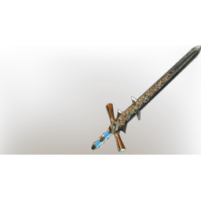

# Greater Twinflame Sword

**4 versions** of this item exist in the game (Weapons). They share the name and the description.

They differ in level range and rarity; the table shows the values per version.

| | Version | Rarity | Level | Stack | Item ID | Own text |
|:---:|---|---|:---:|:---:|---|---|
|  | [1. Greater Twinflame Sword](../../items/weapons/greater-twinflame-sword-2924638789.md) | 🔵 Rare | 26 | 1 | `2924638789` | - |
|  | [2. Greater Twinflame Sword](../../items/weapons/greater-twinflame-sword-3671319442.md) | 🔵 Rare | 36 | 1 | `3671319442` | - |
|  | [3. Greater Twinflame Sword](../../items/weapons/greater-twinflame-sword-751194917.md) | 🔵 Rare | 46 | 1 | `751194917` | - |
|  | [4. Greater Twinflame Sword](../../items/weapons/greater-twinflame-sword-3323951069.md) | 🟠 Legendary | 1-55 | 1 | `3323951069` | - |

## Description

An elaborate sword, decorated in gold filligre. It came from the skies years ago, and fell into the gaping maw of the Howling Peak.

---

[← Weapons](../../categories/weapons.md) · [All categories](../../README.md) · [JSON](greater-twinflame-sword.json)
