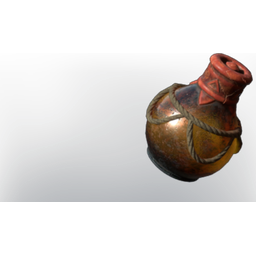

# Incendiary Ball

**2 versions** of this item exist in the game (Weapons). They share the name and the description.

They differ in where to find; the table shows the values per version.

| | Version | Rarity | Level | Stack | Item ID | Own text |
|:---:|---|---|:---:|:---:|---|---|
|  | [1. Incendiary Ball](../../items/weapons/incendiary-ball-1036114942.md) | 🔵 Rare | 35 | 20 | `1036114942` | - |
|  | [2. Incendiary Ball](../../items/weapons/incendiary-ball-1462961786.md) | 🔵 Rare | 35 | 20 | `1462961786` | where to find |

## Description

This ball contains a highly flamable liquid, which will cover an area in fire.

## Where to find per version

**2.** Crafting, Alchemist

---

[← Weapons](../../categories/weapons.md) · [All categories](../../README.md) · [JSON](incendiary-ball.json)
