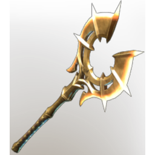

# Jezmina's Apotheosis

**6 versions** of this item exist in the game (Weapons). They share the name and the description.

They differ in level range and rarity; the table shows the values per version.

| | Version | Rarity | Level | Stack | Item ID | Own text |
|:---:|---|---|:---:|:---:|---|---|
|  | [1. Jezmina's Apotheosis](../../items/weapons/jezmina-s-apotheosis-2628423562.md) | 🔵 Rare | 16 | 1 | `2628423562` | - |
|  | [2. Jezmina's Apotheosis](../../items/weapons/jezmina-s-apotheosis-2509571957.md) | 🔵 Rare | 21 | 1 | `2509571957` | - |
|  | [3. Jezmina's Apotheosis](../../items/weapons/jezmina-s-apotheosis-2030714844.md) | 🔵 Rare | 26 | 1 | `2030714844` | - |
|  | [4. Jezmina's Apotheosis](../../items/weapons/jezmina-s-apotheosis-649877474.md) | 🔵 Rare | 36 | 1 | `649877474` | - |
|  | [5. Jezmina's Apotheosis](../../items/weapons/jezmina-s-apotheosis-1323450933.md) | 🔵 Rare | 46 | 1 | `1323450933` | - |
|  | [6. Jezmina's Apotheosis](../../items/weapons/jezmina-s-apotheosis-3153911934.md) | 🟠 Legendary | 1-55 | 1 | `3153911934` | - |

## Description

An axe  which carves a path through enemies no matter what. Swinging it fearlessly makes it feel light as a feather.

---

[← Weapons](../../categories/weapons.md) · [All categories](../../README.md) · [JSON](jezmina-s-apotheosis.json)
