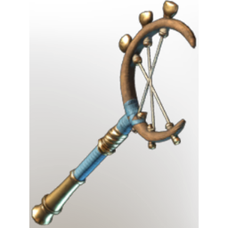

# Proto Bone-Bender

**2 versions** of this item exist in the game (Weapons). They share the name and the description.

They differ in level range and rarity; the table shows the values per version.

| | Version | Rarity | Level | Stack | Item ID | Own text |
|:---:|---|---|:---:|:---:|---|---|
|  | [1. Proto Bone-Bender](../../items/weapons/proto-bone-bender-62683222.md) | 🔵 Rare | 46 | 1 | `62683222` | - |
|  | [2. Proto Bone-Bender](../../items/weapons/proto-bone-bender-1030886695.md) | 🟠 Legendary | 1-55 | 1 | `1030886695` | - |

## Description

A traditional wand that helps to adjust the subject's bones after arrival.

---

[← Weapons](../../categories/weapons.md) · [All categories](../../README.md) · [JSON](proto-bone-bender.json)
