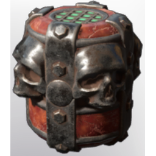

# Skull Summoning Vessel

**2 versions** of this item exist in the game (Weapons). They share the name and the description and where to find.

They differ in level range and rarity; the table shows the values per version.

| | Version | Rarity | Level | Stack | Item ID | Own text |
|:---:|---|---|:---:|:---:|---|---|
|  | [1. Skull Summoning Vessel](../../items/weapons/skull-summoning-vessel-1567174048.md) | 🟣 Epic | 30 | 20 | `1567174048` | - |
|  | [2. Skull Summoning Vessel](../../items/weapons/skull-summoning-vessel-1596935538.md) | 🟠 Legendary | 40 | 20 | `1596935538` | - |

## Description

Throw to summon a skull companion.

## Where to find

Crafting, Collector

---

[← Weapons](../../categories/weapons.md) · [All categories](../../README.md)
