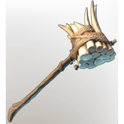

# Soothsayer

**6 versions** of this item exist in the game (Weapons). They share the name and the description.

They differ in level range and rarity; the table shows the values per version.

| | Version | Rarity | Level | Stack | Item ID | Own text |
|:---:|---|---|:---:|:---:|---|---|
|  | [1. Soothsayer](../../items/weapons/soothsayer-1716859550.md) | 🔵 Rare | 16 | 1 | `1716859550` | - |
|  | [2. Soothsayer](../../items/weapons/soothsayer-2385920638.md) | 🔵 Rare | 21 | 1 | `2385920638` | - |
|  | [3. Soothsayer](../../items/weapons/soothsayer-2671987501.md) | 🔵 Rare | 26 | 1 | `2671987501` | - |
|  | [4. Soothsayer](../../items/weapons/soothsayer-2260780998.md) | 🔵 Rare | 36 | 1 | `2260780998` | - |
|  | [5. Soothsayer](../../items/weapons/soothsayer-1166996760.md) | 🔵 Rare | 46 | 1 | `1166996760` | - |
|  | [6. Soothsayer](../../items/weapons/soothsayer-2528480161.md) | 🟠 Legendary | 1-55 | 1 | `2528480161` | - |

## Description

A hammer adorned with an ancient petrified tusk. Tusks and teeth were used by the Vukah for mystical purposes.

---

[← Weapons](../../categories/weapons.md) · [All categories](../../README.md) · [JSON](soothsayer.json)
