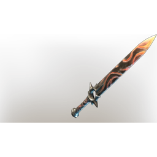
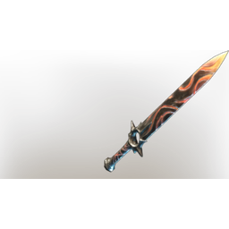

# Wailing Blade

**8 versions** of this item exist in the game (Weapons). They share the name and the description.

They differ in level range and rarity; the table shows the values per version.

| | Version | Rarity | Level | Stack | Item ID | Own text |
|:---:|---|---|:---:|:---:|---|---|
|  | [1. Wailing Blade](../../items/weapons/wailing-blade-3265226455.md) | 🔵 Rare | 6 | 1 | `3265226455` | - |
|  | [2. Wailing Blade](../../items/weapons/wailing-blade-197300979.md) | 🔵 Rare | 11 | 1 | `197300979` | - |
|  | [3. Wailing Blade](../../items/weapons/wailing-blade-4253086109.md) | 🔵 Rare | 16 | 1 | `4253086109` | - |
|  | [4. Wailing Blade](../../items/weapons/wailing-blade-246702506.md) | 🔵 Rare | 21 | 1 | `246702506` | - |
|  | [5. Wailing Blade](../../items/weapons/wailing-blade-456631486.md) | 🔵 Rare | 26 | 1 | `456631486` | - |
|  | [6. Wailing Blade](../../items/weapons/wailing-blade-105288636.md) | 🔵 Rare | 36 | 1 | `105288636` | - |
|  | [7. Wailing Blade](../../items/weapons/wailing-blade-905080090.md) | 🔵 Rare | 46 | 1 | `905080090` | - |
|  | [8. Wailing Blade](../../items/weapons/wailing-blade-1919278140.md) | 🟠 Legendary | 1-55 | 1 | `1919278140` | - |

## Description

An expertly crafter blade, balanced and sharp. Cuts through foes like a wail through the night. It bears the mark of a famous blacksmith from the former capital.

---

[← Weapons](../../categories/weapons.md) · [All categories](../../README.md) · [JSON](wailing-blade.json)
